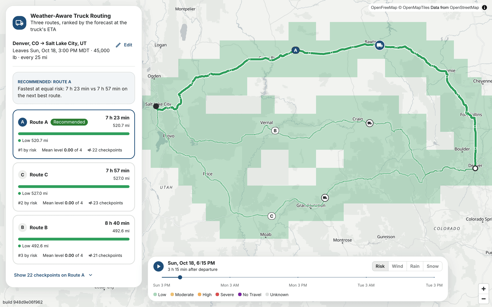

# Weather-Aware Truck Routing

Pick the safest of three truck routes. Enter an origin, a destination, a departure time and the
load. The app reads the forecast where the truck will be when it gets there, every 10, 25 or 50
miles, classifies the risk with load-aware rules and recommends a route. A heatmap of the trip
corridor plays the next 48 hours of weather.

**Live:** https://spotter.akhilsingh.in (the footer shows the deployed commit)



## What it does

- **Three routes** from Stadia Maps' truck routing, which is also given the truck's weight. When
  the router offers fewer than three distinct routes, the rest come from a via point off the
  direct line and are marked Fallback.
- **Checkpoints at the ETA.** Each route gets a checkpoint at the start, every interval and at the
  destination. Each checkpoint's ETA comes from the router's own timing, and its wind, rain and
  snow are interpolated from Open-Meteo's hourly forecast to that minute.
- **Risk levels** from the brief's table and load rules, with the reason for each level. A
  checkpoint without a full forecast is Unknown, never Low.
- **A ranked recommendation** with the reason it won, and a warning when every route crosses No
  Travel weather.
- **The map**: each route coloured by its checkpoints' levels, the selected one on top, with
  tooltips, a checkpoint list and the cards all in sync.
- **The corridor heatmap**: every cell within 25 miles of a route, one request for all 49 hourly
  frames, coloured by risk for this load or by raw wind, rain or snow. The slider and Play move
  each route's truck and never touch the network. The wind, rain and snow views blend between
  hours; the risk view steps from hour to hour, since a blend of two levels' colours is a third
  level's.

## How risk is decided

| Condition | Low | Moderate | High | Severe | No Travel |
|---|---|---|---|---|---|
| Wind (sustained, mph) | < 25 | [25, 35) | [35, 45) | [45, 55) | ≥ 55 |
| Rain (in/hr) | < 0.10 | [0.10, 0.25) | [0.25, 0.50) | [0.50, 1.00] | > 1.00 |
| Snow (in/hr) | < 0.5 | [0.5, 1.0) | [1.0, 2.0) | [2.0, 3.0] | > 3.0 |

- Loads over 30,000 lb raise Severe wind to No Travel; loads over 40,000 lb raise High wind to
  Severe. Gusts only add a flag.
- A checkpoint's level is its worst condition. Each checkpoint owns the stretch of road around
  it, so a route's miles at each level add up to its length.
- Routes rank by miles of No Travel, then miles without a forecast, Severe miles, High miles, the
  mean level, and finally duration. Values compare at the precision the UI shows, so the reason
  never cites a difference the user cannot see.

Every edge in the table and every load rule is tested on both sides. The reasoning, and the gaps
in the brief they settle, are in [risk classification](docs/decisions/risk-classification.md) and
[recommendation](docs/decisions/recommendation.md).

## Performance

- The weather for a whole route is a few batched requests on a shared 0.05° lattice, so nearby
  trips share cached forecasts.
- The heatmap is one response of about 30 KB gzipped for all 49 frames.
- A slider step costs about 11 ms at p95 on an M2 Pro laptop at 2×, including the map redraw, and
  makes no request. The method and numbers are in
  [corridor heatmap D7](docs/decisions/corridor-heatmap.md).

## Architecture

```
browser ── React + MUI ── MapLibre + deck.gl (interleaved)
   │  /api (same origin)
nginx ── gunicorn ── Django + DRF
                      ├── trips/      views and serializers: plan, corridor, places
                      ├── risk/       bands, load rules, scoring, ranking (pure functions)
                      └── providers/  Stadia (routing, geocoding), Open-Meteo (weather), Redis cache
```

API keys stay on the server, units are imperial inside the app and times are UTC until display.
The frontend's API types are generated from the backend's OpenAPI schema, and CI fails when they
drift.

## Run locally

Requires Docker, [uv](https://docs.astral.sh/uv/) and Node 24. A free
[Stadia Maps](https://stadiamaps.com/) key is needed for routing and place search; Open-Meteo
needs none.

```bash
cp backend/.env.example backend/.env   # add STADIA_API_KEY
make dev                               # http://localhost:5173
make sanity                            # lint, types, tests, the web build and the browser test
```

`make help` lists every target.

## Tests

- **Backend:** pytest table tests for every band edge and load rule, and API and provider tests on
  recorded provider responses. No test reaches a live provider.
- **Frontend:** vitest for trip validation, route segments, heatmap colours, frame blending and
  truck positions.
- **End to end:** one Playwright test plans a trip, checks the three routes and the
  recommendation, scrubs and plays the 48 hours, and checks that none of it made a request.

## Deploy

`make deploy` builds both images, ships them to the VM over SSH and waits until the live API
reports the new commit. Details: [deployment decisions](docs/decisions/deployment.md).

## Documentation

- [Spec](docs/SPEC.md): the brief and its gaps
- [Context](docs/CONTEXT.md): domain vocabulary
- [Decisions](docs/decisions/README.md): every design choice, with the alternatives rejected
- [Walkthrough](docs/WALKTHROUGH.md): the demo outline, by grading area
- [Workflow](docs/ISSUE_WORKFLOW.md): how issues become merged PRs
- [Backlog](docs/BACKLOG.md): what was deliberately left out
- [AGENTS.md](AGENTS.md): working rules for anyone changing the repo

## How it was built

Each piece of work was an issue, a branch and a pull request. The decision record for the area
came first and the code followed in small commits, each green on its own. Every PR ran the CI gates
before it merged. From #21 on, each also had an adversarial review; the findings and fixes are in
the PR's comments. A decision, once recorded, changed only through a PR that edited it.
